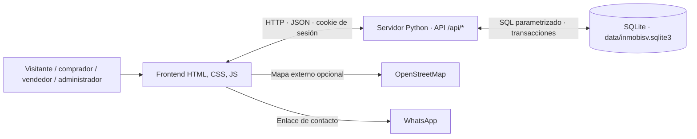
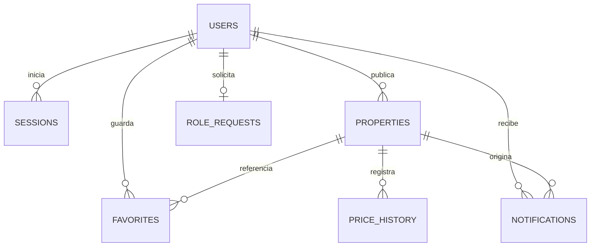

# InmobiSV | Infraestructura y arquitectura técnica

**Propósito:** Proyecto académico de Ingeniería en Desarrollo de Software para centralizar las publicaciones de terrenos en El Salvador. Implementación local, pequeña y reproducible sin servicios de pago.

## 1. Tecnologías utilizadas

| Capa | Tecnología | Responsabilidad |
|---|---|---|
| Frontend | HTML5 | Estructura semántica, formularios, diálogo y navegación |
| Estilos | CSS3 | Grid, Flexbox, diseño responsive, paleta verde y tonos naturales |
| Interacción | JavaScript ES6+ (sin framework) | Eventos, filtros, comparación, navegación por hash, validación visual y consumo de API mediante fetch |
| Backend | Python 3.10+ | Lógica de negocio, permisos, validación y servidor HTTP mediante `http.server.ThreadingHTTPServer` |
| Base de datos | SQLite 3, módulo `sqlite3` | Persistencia relacional en un archivo local, transacciones, restricciones y consultas parametrizadas |
| Autenticación | `hashlib`, `secrets`, `hmac`, cookies | Hash de contraseña PBKDF2, sesiones persistentes con caducidad y roles |
| Imágenes | SVG local, JPEG/PNG/WebP | Ilustraciones de ejemplo y hasta cuatro archivos de imagen por publicación, almacenados como JSON/Data URL en SQLite |
| Mapas | OpenStreetMap | Mapa embebido aproximado y enlace externo; Internet necesario |
| Contacto | WhatsApp (`wa.me`) | Enlace al número informado por el vendedor, solo en anuncios no ficticios con teléfono válido |
| Control de versiones | Git | Historial del código; repo local preparado para GitHub |
| Pruebas | Python `unittest`, `urllib` | Verificación de integración mediante HTTP real y base temporal |

## 2. Arquitectura

La aplicación adopta un esquema cliente-servidor de tres capas, desplegado en un único equipo. El navegador no accede directamente a la base de datos.

**Despliegue local:** `127.0.0.1:8000`; servidor Python y archivo SQLite en el mismo equipo. El frontend lo sirve el backend, de modo que no se requiere CORS, otro puerto ni servidor adicional. API y páginas comparten origen.

## 3. Modelo de datos

| Tabla | Datos principales | Función |
|---|---|---|
| `users` | id, nombre, correo único, hash de contraseña, rol, teléfono, activo | Cuentas y permisos |
| `sessions` | hash del token, user_id, caducidad | Sesión de 24 horas |
| `properties` | seller_id, título, ubicación, área/dimensiones, precio, descripción, tipo, fotos, coordenadas, estado, indicador demo | Catálogo y publicaciones |
| `favorites` | user_id, property_id, precio guardado | Preferencias del comprador, sin duplicados |
| `price_history` | property_id, precio anterior y nuevo, fecha | Trazabilidad de cambios |
| `notifications` | user_id, property_id, mensaje, leído, fecha | Avisos internos por reducciones de precio |
| `role_requests` | user_id, estado | Solicitud y decisión del administrador |

Se eligió una implementación relacional compacta: los datos de Terreno, Ubicación y Fotografías del UML conceptual se integran en `properties`, y los tres roles se representan con una columna restringida en `users`, en lugar de tablas por subclase. La comparación es una selección temporal en memoria del navegador. Esto simplifica la entrega académica; no pretende reproducir literalmente todas las clases del UML.

## 4. Roles y permisos

| Operación | Visitante | Comprador | Vendedor | Administrador |
|---|---|---|---|---|
| Explorar, filtrar, detalle y comparar | Sí | Sí | Sí | Sí |
| Contactar mediante enlace válido | Sí | Sí | Sí | Sí |
| Guardar favoritos y consultar avisos | No | Sí | No | No |
| Solicitar rol vendedor | No | Sí | No | No |
| Crear y editar anuncios | No | No | Solo propios | No |
| Cambiar disponibilidad | No | No | Solo propios no moderados | Sí, todos |
| Administrar usuarios y solicitudes | No | No | No | Sí |

El administrador es un rol nuevo solicitado para esta versión, adicional al modelo de cliente y vendedor original. La solicitud de cambio de rol se comprueba y decide desde el panel administrativo; no implica verificación documental real.

## 5. API HTTP

| Método y ruta | Función |
|---|---|
| GET `/api/me` | Perfil de sesión |
| POST `/api/register`, `/api/login`, `/api/logout` | Alta, inicio y cierre de sesión |
| GET `/api/properties` | Catálogo de anuncios activos |
| GET `/api/my-properties` | Publicaciones propias del vendedor |
| POST `/api/properties` | Nueva publicación |
| PUT `/api/properties/{id}` | Editar anuncio y registrar cambios de precio |
| PATCH `/api/properties/{id}` | Cambiar estado / moderar |
| GET `/api/favorites`, POST/DELETE `/api/favorites/{id}` | Consultar/agregar/quitar favoritos |
| GET `/api/notifications`, POST `/api/notifications/read` | Avisos internos |
| PATCH `/api/profile` | Actualizar teléfono |
| POST `/api/role-request` | Enviar solicitud de vendedor |
| GET `/api/admin` | Resumen administrativo |
| PATCH `/api/admin/users/{id}`, `/api/admin/requests/{id}` | Habilitar usuarios o resolver solicitudes |

Las operaciones que escriben requieren un encabezado personalizado y JSON; el servidor no permite CORS. Las rutas protegidas validan la sesión y el rol; los cambios de vendedor comprueban además que sea propietario. Los códigos de error incluyen 400, 401, 403, 404, 409 y 413. El frontend realiza filtros y comparaciones con el catálogo obtenido de la base; para conjuntos grandes convendría paginar y filtrar en el servidor.

## 6. Correspondencia con los procesos del proyecto

| Proceso | Implementación de esta entrega |
|---|---|
| P01 / P02 | Registro de vendedor y comprador, validación y hash de contraseña |
| P03 | Solicitud de cambio de rol, revisión de teléfono y aprobación administrativa |
| P04 / P05 | Catálogo público, filtros locales de datos provenientes de SQLite |
| P06 | Galería de imágenes, detalle, mapa aproximado opcional; puntos de interés consultables vía enlace externo, sin evaluación automática de ubicación |
| P07 | WhatsApp para anuncios no ficticios con número válido |
| P08 | Formulario de publicación de tres pasos con fotos |
| P09 | Edición, pausa, reactivación y estados vendido/rentado |
| P10 | Favoritos persistentes |
| P11 | Historial de precios y aviso interno a compradores interesados |
| P12 | Comparación de dos a cuatro terrenos disponibles (temporal por sesión de navegador) |

## 7. Requisitos operativos

- Desarrollo: cualquier equipo con Python 3.10+, navegador y disponibilidad de escritura en la carpeta del proyecto.
- No hay servidor de base de datos separado, Docker, Node.js ni servicios de pago. Node se utilizó únicamente para verificar sintaxis JS durante la preparación, no es requisito de ejecución.
- Internet solo para mapa y WhatsApp. Todos los SVG y estilos están en el repositorio.
- Persistencia: conserva `data/inmobisv.sqlite3`; detener el servidor antes de copiar el archivo como respaldo. No subir la base al repositorio.
- Consideraciones: la aplicación usa consultas parametrizadas, sesiones con hash y controles de acceso. No se diseñó para Internet abierto; no hay TLS de desarrollo, limitación de intentos, revisión de archivos avanzada, verificación de correo ni verificación de propiedad. Las imágenes dentro de SQLite y el servidor estándar simplifican la demostración, pero no son ideales para producción.

## 8. Puesta en marcha

Consultar `README.md` para los comandos exactos, los usuarios de prueba, la demostración y la configuración de GitHub.
